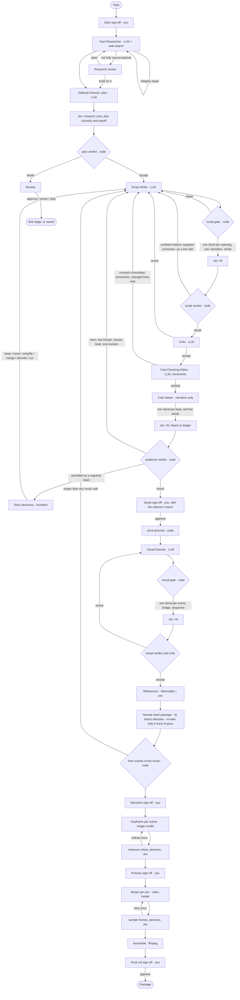

# Architecture: How a Story Becomes a Video

The pipeline, its parts, and why it is shaped this way. The look, voice and taste are not here:
they live in a theme ([themes.md](themes.md)). Module-level detail is in
[codebase.md](codebase.md); every model is in [models.md](models.md).

Last reviewed: 2026-10-04.

## The Principle

The narration is the spine:

```text
Research → Plan → Narration → Fact check → Listener test → Storyboard → Recording → Keyframes → Morphs → Edit
```

- Research is focused, source-aware, and open about disagreement.
- The plan chooses one angle rather than passing every fact downstream.
- The narration is one connected story. Its units are editorial meaning blocks; the consecutive
  units of one beat are spoken as one passage, in one take.
- The whole spoken story is fact-checked before anything visual is made.
- Pictures clarify, prove, reinforce or bridge the narration; they never tell a second story.
- Subtitles are the only text on screen, drawn by code from the script's own words; image and
  video models are never asked for text.
- One scene per beat, each flowing into the next through a planned morph bridge.

## Three Kinds of Thinking

After Kahneman:

- **System 2, generative models,** do the work that needs reasoning: research, the creative plan,
  the narration, the fact audit, the storyboard. Each role has its own model, chosen in
  configuration.
- **System 1, Jev,** makes fast, typed judgements (yes/no, a choice, or a score, with
  probabilities) about every node and connection of the story. Those judgements drive routing.
- **Code** does everything exact: references, word counts, timing, colour measurement,
  thresholds, budgets and caching.

**A person** directs: one round of questions at the start (format, length, scenes, angle),
then five sign-offs, six for long form with the Story plan, each before money is spent on the
next step ([runs-and-review.md](runs-and-review.md)). An assistant answers the reviews in
between.

**One channel, several shapes.** The theme fixes the look, voice and music; each video picks a
format from the theme's `formats` (short 9:16, long 16:9), a length and a scene count
(`choices.py`, applied by `configure_run` to the configuration before the graph is built).

## The Five Agents

Each is a folder in `agents/` with `agent.py` (the code) and `prompt.md` (its job and craft,
theme-neutral); what it returns is a record in `schemas/`. The theme's `SKILL.md` supplies the voice and look every creative agent
works in.

1. **Fact Researcher:** discovers and compares sources (the only agent with web search),
   classifies claims, builds a timeline, a cast and the documented links between events, and
   records uncertainty.
2. **Editorial Director, the Story Architect:** writes the creative plan and its story ledger
   (System 2) and owns every creative judgement (System 1, through Jev). As the critic, it reads
   a whole script or storyboard when Jev is unsure; as the cold viewer (a separate model, given
   only the narration), it hears the verified script as a first-time listener; after that test,
   it decides what happens to a required claim the listener stumbled on.
3. **Script Writer, the storyteller:** writes every word of the narration from the plan, the
   claims it selected and every fact constraint, including the oral revision after the
   listener test. A revision whose notes all name their lines is a **line edit**: a small model
   (`LINE_EDIT.md`) rewrites only those lines, and code keeps every other line exactly
   ([Revision Scopes](#revision-scopes)).
4. **Fact-Checking Editor:** audits every spoken unit against the research pack, or declares it
   non-factual, and returns constraints, never wording.
5. **Visual Director:** storyboards anchored scenes, each with a named focus and a morph bridge
   into the next.

## Who Decides What

| Role | Node | Decides | Never |
|---|---|---|---|
| Truth | Fact-Checking Editor | the evidence boundary: what may be said | writes prose: findings are constraints (`issue`, `evidence_boundary`, `required_qualification`, `forbidden_implication`, `severity`) |
| Story Architect | Editorial Director (plan, story decisions) | what matters and how the story is structured: the story ledger | writes narration |
| Storyteller | Script Writer | how it is said: every word, every revision | drops a required claim or crosses a fact constraint |
| Audience | cold viewer (Editorial Director's role, separate model, narration only) | whether a first-time listener understood | sees research, plan, claims or fact checks |
| Judges | Jev and code | pass or fail against the ledger and the constraints | write |

The **story ledger** lives in the plan (`EditorialBrief`) and is the single global story
state. Per beat: its role (hook, orient, cause, explain, escalate, reveal, contrast,
consequence, resolve), purpose, what the listener knows after it, the question it answers,
the one it leaves and what will answer it, and why the next beat follows (what they knew and
wondered before a beat is the previous beat's answer; the first starts from
`audience_starts_knowing`). Per claim: its story role (spine, essential context, supporting
evidence, colour, expendable), its job in the story, its meaning, whether it needs
explaining, and which claim it supports. The required, supporting and excluded claim lists
are derived from those roles, and each beat's time from them
([narration.md](narration.md#time-by-story-role)).

Jev is a tool the Editorial Director uses, not a sixth agent. Media generation and assembly are
code (`production/`), not an agent: a vision model describes each render (following
`agents/editorial_director/PERCEPTION.md`) and Jev judges the description.

Each agent receives only what its job needs: the writer, the research summary, the plan and
its ledger (without the visual principles and fact-check priorities, which are other agents'),
the claims the plan selected with their qualifications and safe wording, and every fact
constraint so far; a line edit, only each named line, its neighbours, its beat, its claims and
their limits, and the notes on it; the fact checker, the full research and the script units; the
Visual Director, the plan's visual fields, the units and the sources. Each Jev task sends only the
state fields its questions name. The fact check is incremental: a unit whose text, claims and
research are unchanged keeps its audit.

## Revision Scopes

A revision reaches only as far as its notes (`story/revision_scope.py`, `ScriptWriter`):

| Change | Who | What is redone |
|---|---|---|
| The person rewrites a line in their own words (Edit, at the Script sign-off) | code: the words go in exactly, no model call | Jev on that line and its joins, the whole-script question, the fact check of that line, the listener, that passage's audio |
| Notes that all name lines (`U3: …`, `U3->U4: …`), at most a third of the lines (or any number when the person asks for lines) | line edit: the edit model (`agents.script_writer.edit_model`, Claude Haiku 4.5) on those lines, given only each line, its neighbours, its beat, its claims and their limits, and the notes | the same, for the edited lines |
| A line the small model edited comes back from the next check | line edit on the writer's own model | the same |
| A note on the whole script, too many lines, the listener's report, a story decision, or the person ticking "rewrite the whole script" | whole rewrite on the writer's model | everything, as before |

- Code keeps every line not named byte for byte; a line edit cannot touch them.
- The person's own words are **locked**: never a target, exempt from the blocking prose checks
  (shown as advice instead), given to every whole rewrite as `locked_lines`, and a rewrite that
  loses one is sent back by the script gate.
- Every change is a `LineEdit` (line, before, after, author `person`, `editor` or `writer`,
  reason, revision) in state and in `resume.json`; the Script sign-off shows each line's latest.
- After a line edit, judgements of targets it did not touch that passed are carried to the new
  revision (`revision_scope.unchanged_judgements`) and not asked again; the whole-script
  question, touched lines, their joins (and the opening, when either of the first two lines
  changed), and anything that did not pass are asked again. A line's own judgement still reads
  the lines before it, so an earlier change is not re-judged there; that is accepted.

## Two Graphs

1. The **execution graph** is fixed LangGraph topology, defined only in `workflow/graph.py`.
2. The **story graph** is generated content: arc phases, script units and scenes, linked by
   transitions, morph bridges, claim references and scene-to-unit references. `story/ledger.py`
   validates it and turns each node and edge into one focused Jev task; the graph runs those
   tasks in parallel with LangGraph `Send`.



A line edit is one small call (about $0.01) instead of a whole rewrite (about $0.15–0.35).
A clean pass makes five generative text calls (research, plan, script, fact check, storyboard)
and one small listener call, plus a few dozen small parallel Jev calls. Each oral revision round
adds a writer call, the fact check of changed lines, and another listener test (about
$0.15–0.40), within the script's revision allowance. Production then records one take per passage (more if
a take is far off pace), draws one keyframe per scene and makes one morph per join.

## How Judgements Become Routes

`judging/outcomes.py` turns answers into outcomes; `workflow/routing.py` turns outcomes into edges.

- Jev's 41 questions live in `judging/questions.py`. Each asks one thing about
  one target and names the state fields it relies on. Taste comes from the theme: pictures are
  judged against the theme's look, the script's voice against `writing.voice`.
- Each answer becomes `pass`, `fail` or `unsure` using the thresholds in `decisions` (yes ≥ 0.6,
  no ≤ 0.2, choices and scores unsure below 0.5 confidence).
- Questions listed under `decisions.blocking` affect routing; the rest are advice. Measurement
  questions (`claim_worth`, `claim_connection`, `unit_reaction`, `unit_intensity`,
  `script_voice`) never pass or fail; code reads them.
- A confident blocking failure sends a fixed correction line naming the unit or scene back to its
  writer (or re-renders a keyframe or morph). Blocking doubt goes to the critic. Every automatic
  revision spends from `workflow.max_revisions`; when the allowance is spent, the run asks.
- Every judgement is kept with its probabilities, model and the artifact revision it judged, so
  thresholds can be tuned from real runs ([machine-learning.md](machine-learning.md)).

## The Research Standard

- For a well-documented topic: about 6–10 credible sources and 12–20 concise classified claims
  across the evidence categories (verified, reported, disputed, inference, unsupported), with
  primary or official support where available and independent corroboration. These are working
  limits, not quotas; research stops once the central record, important context, material
  uncertainty and one viable story are supported.
- Research also records a cast and the documented links between events; only a `led_to` link may
  be told as cause. The researcher writes a short `status_reason`, shown at the research review.
- Each claim has a stable ID (`C14`) and its source IDs; script units list the claims they use, so
  every spoken statement is traceable to evidence.
- When research is not fully source-backed after one automatic repair, the run pauses at a
  **research review**: build only on what is documented (anything else stated as attributed
  allegation), steer another pass, or stop. With nothing documented, only steer and stop.
- Supplied sources (`--sources`) and a brief (`--brief`) are evidence and direction, never limits:
  the researcher checks the brief's points first, still searches to corroborate, and a point is
  stated as fact only when the research supports it.

## The Story's Shape

- **Understanding per minute, not information.** The plan first writes the `story_chain`: the
  story as a first-time listener could retell it. Each beat then answers what happens, why it
  matters, and why the next beat follows; `explain` lists every term, institution or figure the
  narration must explain, with the claims behind each plain version. The writer, Jev
  (`unit_clear`, `unit_meaning`, `transition_why`), the critic, the fact checker and the cold
  viewer all hold the script to that
  ([narration.md](narration.md#the-standard-understanding-per-minute)).
- **The plan decides what matters; code decides how long.** A spine of 4–7 beats, each with one
  role and linked to the last by *but* or *therefore*, carrying its claims. Code gives each beat
  the time its claims' story roles and weights deserve, then snaps the total to the edits the
  music offers ([narration.md](narration.md#time-by-story-role)). What was left out, and why, is
  recorded.
- **Open weights** give each claim evidence, worth and connection numbers (theme
  `writing.weights`); they advise which facts to build on, how each beat is told (`logic`,
  `feeling`, `curiosity`) and how firmly each claim is stated (assert, attribute, ask)
  ([machine-learning.md](machine-learning.md#open-story-weights-2026-09-27)).
- **The opening has two jobs:** the hook (the plan's most arresting *verified* fact, said as
  tension, never as a date or a setting; allegations never hook) and the orientation (who, what,
  and why it matters). Code checks the hook rests on verified claims; Jev judges whether it grips
  and whether a listener knows who and what this is about. Scene 1 shows the hook from the first
  frame.
- **Robotic writing** is caught before any audio exists (`story/prose.py`), and a local inference model
  flags a line its own claims contradict ([narration.md](narration.md#2-writing-for-the-ear)).

## The Package

Every run lives in `runs/<topic>/` ([runs-and-review.md](runs-and-review.md)). A finished run also
writes the structured `FinalContentPackage` (`.work/session-N.json`) and readable Markdown
(`.work/session-N.md`):

```text
FinalContentPackage
├── research_pack
├── editorial_brief          (the creative plan)
├── approved_script          (units, computed hook and master script, voice direction)
├── narration_prompt
├── fact_check_report
├── visual_plan              (the storyboard)
├── scene_prompts            (the exact keyframe and morph prompts code built)
├── production               (video, narration, subtitles, music, storyboard, timings)
└── human_decisions
```

The master script and hook are computed from the ordered units: one source of truth for the
spoken story. Model-facing schemas validate only what providers can satisfy directly;
cross-record problems (unknown references, uncovered units, overlong narration) never discard a
paid response, they block progress and send a targeted repair to the owning stage. Without a
`production` section in the configuration, a run stops at this package as a prompt pack for manual
use.

## Boundaries

- Jev reads text only: pictures and morphs are judged from a vision model's description; the
  voice and overall feel need a person.
- Thresholds and blocking questions are starting values, to be tuned from recorded judgements.
- A busy or failing provider is retried for about two minutes; if a call still fails, the run
  stops but keeps what it paid for and prints the exact resume command. A generation refused by
  content policy is retried in a safer form instead of stopping.
- The fact check audits against the research record; it does not fetch sources itself. Code
  guarantees only that every unit gets a disposition.
- The fake providers demonstrate structure and routing, not research, writing or judgement
  quality. Real output quality remains probabilistic.
- Out of scope: publishing, caption and hashtag copy, thumbnails, sound effects, and production
  infrastructure (servers, queues, cloud storage): media is API calls, a local content-addressed
  cache and ffmpeg.
